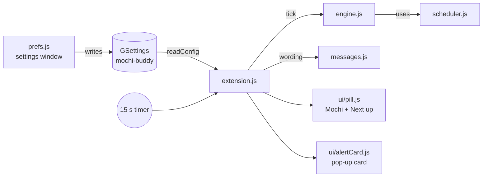

# Architecture

## The big picture

There are two separate programs:

- **The shell part** (`extension.js` and `lib/ui/`) runs inside GNOME Shell. It draws Mochi and checks the clock.
- **The settings window** (`prefs.js`) runs in its own process. It cannot talk to the shell part directly.

They share data through **GSettings**. The settings window writes a value, GNOME tells the shell part "this key changed", and the shell part re-reads it. That is also how the **Test** button works: it bumps the `test-reminder` number and the shell part reacts.

## Files

| File | Job | Uses GNOME? |
| --- | --- | --- |
| `extension.js` | Starts and stops everything. Runs a timer every 15 seconds. Keeps the queue of cards. Places Mochi on screen. | Yes |
| `prefs.js` | The settings window (GTK 4 + libadwaita). | Yes |
| `lib/scheduler.js` | Answers "when does this reminder happen?" Parsing times, repeat rules, formatting. | No |
| `lib/engine.js` | Answers "what should fire right now?" Remembers what already fired, handles snooze and heads-up. | No |
| `lib/messages.js` | Everything Mochi says on the card and in the pill. | No |
| `lib/store.js` | Reads all settings into one plain object, writes reminders and workdays. | GLib only |
| `lib/ui/pill.js` | The corner widget. Closed = Mochi only. Open = Mochi, "Next up", countdown chip, gear. | Yes |
| `lib/ui/alertCard.js` | The pop-up reminder card with Done and Snooze. | Yes |
| `lib/ui/mascot.js` | Loads Mochi's face for each mood. | Yes |
| `lib/ui/compat.js` | Smooths over differences between GNOME 45 and 51. | Yes |

Files marked "No" have no GNOME imports, so they run in Node and are covered by `tests/`.

## What happens on each tick

1. `extension.js` reads settings (cached until something changes).
2. `engine.tick()` lists reminders that became due since the last tick.
3. Each one goes into a queue. Cards show one at a time.
4. If a "Just once" reminder fired, it is switched off in settings.
5. If something is 5 minutes away and heads-up is on, Mochi wiggles.
6. The pill text, countdown, badge dot and Mochi's mood are refreshed.

## Where Mochi lives on screen

Mochi and the card are added with `Main.layoutManager.addChrome()`. That puts them above normal windows, lets them take clicks, and hides them when an app is full screen. They are pinned to the bottom-left of the **primary monitor**, 12 px from the edges, and move when monitors change.

## Key decisions

- **Own widget, not GNOME notifications.** GNOME's notification banners appear at the top and look like every other app. Mochi's card appears next to Mochi so it feels like one character talking to you.
- **Pure logic kept apart from UI.** Time math is the easiest place to make mistakes, so it lives in files that can be tested without GNOME.
- **Reminders stored as JSON in one string key.** GSettings has no "list of objects" type. One JSON string is simple, and `sanitizeReminders()` throws away anything broken.
- **No keyboard grab.** The card never steals focus from what you are typing.
- **Respect the user.** No sound in Do Not Disturb, no animation when "reduce motion" or "animations off" is set.

## Version support

`metadata.json` lists GNOME 45 to 51. The known differences are handled in `lib/ui/compat.js`:

- Vertical boxes: GNOME 45 to 47 use `vertical: true`, 48+ use `orientation`, and 51 removed `vertical`.
- Reduced motion: GNOME 51 added `St.ReducedMotion`. Older versions only have "enable animations".
